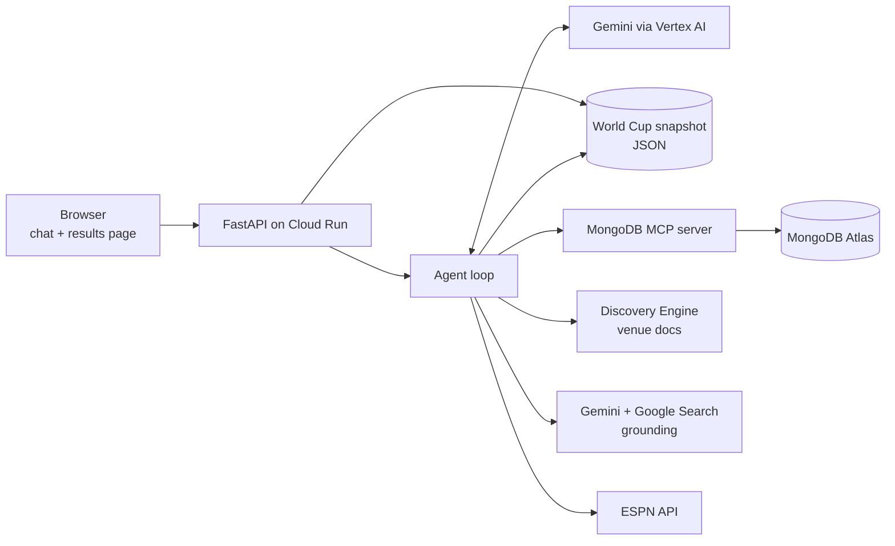

# MatchDay — Your AI football companion

> A conversational AI agent for football fans. Ask about any league, club, player or transfer, relive every result of the FIFA World Cup 2026, follow teams, and get guides to the World Cup host stadiums.

**Live demo:** [matchday-901040990547.us-central1.run.app](https://matchday-901040990547.us-central1.run.app/) · **World Cup 2026 results page:** [/results](https://matchday-901040990547.us-central1.run.app/results)

<!-- Screenshots: chat on desktop, the /results bracket, and the chat on a phone. -->

Originally built for the **Google Cloud Rapid Agent Hackathon** (MongoDB partner track) as a World Cup 2026 assistant, now a general football companion.

> **Demo note:** there's no authentication. Each visitor gets a random guest ID stored in their browser, but the ID is just a label: anyone who knows it can see and change what it follows. Don't put personal information in it.

---

## What it does

- **Any football question.** Other leagues, clubs, players, transfers and news are answered with Gemini's grounded Google Search. The agent is told never to say it doesn't know a football question without searching first, and to verify claims about the current state of football (who plays where, who manages whom, league positions) in the same turn.
- **World Cup 2026 recap.** All 104 matches (June 11 – July 19, 2026) are in a static snapshot. The agent answers results, a team's run and the knockout path from it, and the [results page](https://matchday-901040990547.us-central1.run.app/results) shows the full bracket from the round of 32 to the final, with extra-time and penalty results marked, plus every group-stage result.
- **Follow teams.** Any real club or national team, saved per user in MongoDB through the MongoDB MCP server. Made-up teams are refused.
- **Host city venue guides.** Retrieval-augmented answers about World Cup 2026 stadiums (getting there, what's nearby) from a Google Cloud Discovery Engine data store.
- **Head-to-head records** between any two teams.

**Coming soon:** live fixtures for more competitions. Match reminders (with email delivery) and score predictions (3 points for an exact score, 1 for the right winner, with a leaderboard) are implemented, but they need upcoming fixtures, so the agent currently explains that they're coming soon instead of inventing matches.

---

## Engineering highlights

- **Custom tool-calling loop, no agent framework.** 21 tools declared for Gemini via the `google-genai` SDK. Model calls retry 429/500/503 with exponential backoff and jitter, and a failed turn is rolled back from conversation history so a half-finished function call can't break later messages.
- **MongoDB MCP integration.** The MongoDB MCP server runs as a Node.js subprocess started in the FastAPI lifespan. Every agent read and write of user state goes through it (`find`, `insert-many`, `update-many`, `delete-many`, `aggregate` for the leaderboard), and every call result is checked for errors, so the agent can tell "nothing found" apart from "the call failed".
- **System instruction as a file.** The prompt lives in [`prompts/system_instruction.md`](prompts/system_instruction.md), with today's UTC date and the user ID filled in on every request, so the model never relies on its training data for "today". The app refuses to start if the file or a placeholder is missing. User IDs are validated (`[A-Za-z0-9_-]{1,40}`) because they're inserted into the prompt.
- **Validated static data.** [`scripts/snapshot_world_cup.py`](scripts/snapshot_world_cup.py) pulls every match from ESPN and only writes the snapshot if it finds exactly 104 matches and every computed winner (including penalty shootouts) agrees with ESPN's own winner flag. The bracket order on the results page is derived from match winners and fails loudly if the rounds don't fit together.
- **Measured retrieval, not guessed.** A retrieval eval found the main failure mode, and its fix is now in production (see [Evaluation](#evaluation)).
- **Hardened public frontend.** Replies are rendered with `marked` and sanitized with DOMPurify, both pinned from cdnjs with Subresource Integrity hashes. Guest IDs are `g_` plus a UUID v4.

---

## Architecture



| Capability | Tools | Backend |
|---|---|---|
| World Cup 2026 results | `get_world_cup_results` | Static JSON snapshot built from ESPN ([`data/world_cup_2026.json`](data/world_cup_2026.json)) |
| General football, head-to-head | `web_search`, `head_to_head` | Gemini with Google Search grounding |
| Venue guides | `search_venue_info` | Google Cloud Discovery Engine |
| Follows, reminders, predictions | `follow_team`, `save_reminder`, `save_prediction`, `get_leaderboard`, ... | MongoDB Atlas via the MongoDB MCP server |
| Fixtures | `get_upcoming_matches`, `get_team_schedule`, ... | ESPN public API (World Cup league only for now) |

A background asyncio task checks MongoDB (directly with `pymongo`) every 30 seconds for due reminders and sends emails via Brevo SMTP.

---

## Evaluation

The venue retrieval was evaluated on 28 hand-labeled queries (24 answerable, 4 out-of-scope), calling the same retrieval function the agent uses.

- **Diagnosis:** at the API's default settings, 10 of 28 queries returned no documents at all. One was out-of-scope, where empty is correct; the other 9 accounted for 9 of the 10 answerable misses. Probing showed Discovery Engine's relevance threshold was discarding correct results for short or loosely worded queries, not ranking them badly.
- **Fix:** a sweep across threshold levels, then `LOWEST` in production. Out-of-scope questions are left to Gemini, which is told to decline rather than fabricate.

| Threshold | hit@2 | recall@2 | MRR | Abstention (out-of-scope) |
|---|---|---|---|---|
| API default | 0.583 | 0.569 | 0.583 | 0.25 |
| `LOWEST` (production) | **0.917** | **0.903** | **0.894** | 0.00 |

@2 is the production cutoff, since the agent receives the top 2 documents. Methodology, the remaining misses, limitations and next steps are in [docs/EVALUATION.md](docs/EVALUATION.md).

---

## Tech stack

- **Model:** Gemini via Vertex AI, using the `google-genai` SDK. The agent model is set by `GEMINI_MODEL` (default `gemini-3.1-pro-preview`).
- **Backend:** Python 3.11, FastAPI and uvicorn on Cloud Run.
- **User state:** MongoDB Atlas via `mongodb-mcp-server` 1.11.0 (pinned; Node.js 22+).
- **Retrieval:** Google Cloud Discovery Engine (AI Applications), documents in Cloud Storage.
- **Frontend:** plain HTML, CSS and JavaScript, with `marked` and DOMPurify.
- **Email:** Brevo SMTP.
- **Config and secrets:** GCP Secret Manager.

---

## Running locally

Requires Python 3.11 (3.10 works for local dev), Node.js 22+, a MongoDB Atlas cluster, and a GCP project with Vertex AI and Discovery Engine set up.

```bash
python -m venv venv
source venv/bin/activate          # Windows: venv\Scripts\activate
pip install -r requirements.txt
npm install -g mongodb-mcp-server@1.11.0
```

Create a `.env` in the repo root with `MONGODB_URI`, `GCP_PROJECT_ID`, `DISCOVERY_ENGINE_LOCATION`, `DISCOVERY_ENGINE_ID`, `BREVO_SMTP_LOGIN`, `BREVO_SMTP_KEY` and `BREVO_SENDER_EMAIL` (optionally `GEMINI_MODEL`), then:

```bash
uvicorn main:app
```

The MongoDB URI must include the database name (`.../wc2026?...`), and `mongodb-mcp-server` must stay on 1.11.0: version 3.x changed its tool signatures.

---

## Testing

```bash
pip install -r requirements-dev.txt
pytest                                             # unit tests, no network calls
```

Unit tests cover the retrieval metrics, the ESPN snapshot parsing (against a saved ESPN response), World Cup results filtering, team name aliases and the bracket ordering.

The retrieval eval calls Discovery Engine, so it costs a little per run:

```bash
python -m tests.eval.rag_eval --limit 3            # quick smoke run
python -m tests.eval.rag_eval --threshold LOWEST   # full run at a given threshold
```

Each run writes one self-contained line per query to `tests/eval/results/<timestamp>_rag_<threshold>/raw.jsonl`.

To rebuild the World Cup snapshot from ESPN: `python -m scripts.snapshot_world_cup`.

---

## Deployment

The live demo runs as the Cloud Run service `matchday` in `us-central1`, in low-cost mode: **minimum 0 instances, default CPU throttling**. That has two consequences:

- The first request after an idle period has a cold start (container boot plus the MCP subprocess), and the chat shows a "waking up" message while it waits.
- The reminder worker is paused between requests, so reminders are saved but not reliably emailed. The planned fix is Cloud Scheduler calling an endpoint periodically.

```bash
gcloud run deploy matchday \
  --source . \
  --region us-central1 \
  --allow-unauthenticated \
  --set-secrets="MONGODB_URI=MONGODB_URI:latest,GCP_PROJECT_ID=GCP_PROJECT_ID:latest,DISCOVERY_ENGINE_LOCATION=DISCOVERY_ENGINE_LOCATION:latest,DISCOVERY_ENGINE_ID=DISCOVERY_ENGINE_ID:latest,BREVO_SMTP_LOGIN=BREVO_SMTP_LOGIN:latest,BREVO_SMTP_KEY=BREVO_SMTP_KEY:latest,BREVO_SENDER_EMAIL=BREVO_SENDER_EMAIL:latest" \
  --min-instances 0 \
  --cpu-throttling \
  --timeout 300 \
  --memory 1Gi
```

**Discovery Engine setup:** upload the files in `venue_docs/` to a Cloud Storage bucket, create a Discovery Engine data store on that bucket, create a Search app on top of it, and use the app's ID as `DISCOVERY_ENGINE_ID`.

---

## Repository structure

```text
matchday/
├── main.py                     # FastAPI app: MCP lifespan, chat API, results API, pages
├── agent.py                    # Gemini tool-calling loop, tool declarations, dispatch
├── gemini_client.py            # Shared Gemini client and retry with backoff
├── prompts/
│   └── system_instruction.md   # System instruction template ({{user_id}}, {{today}})
├── results.py                  # Shapes the snapshot into bracket order for /results
├── tools/
│   ├── world_cup.py            # World Cup 2026 results from the snapshot
│   ├── web_search.py           # Gemini grounded search, head-to-head
│   ├── venues.py               # Discovery Engine retrieval
│   ├── mongodb_mcp.py          # Follows and reminders via MCP
│   ├── predictions.py          # Predictions, scoring, leaderboard via MCP
│   ├── espn.py                 # ESPN API, team name aliases
│   ├── reminder_worker.py      # Background reminder scheduler
│   └── email_sender.py         # Brevo SMTP
├── data/
│   └── world_cup_2026.json     # Static snapshot of all 104 matches
├── static/
│   ├── index.html              # Chat UI
│   └── results.html            # World Cup 2026 results and bracket
├── scripts/                    # Snapshot builder, retrieval probes, utilities
├── tests/
│   ├── unit/                   # Unit tests (pytest)
│   ├── fixtures/               # Saved ESPN response for parser tests
│   └── eval/                   # Retrieval eval: metrics, runner, dataset
├── docs/
│   └── EVALUATION.md           # Retrieval evaluation writeup
├── venue_docs/                 # Source documents for Discovery Engine
├── .claude/skills/             # Claude Code skills for adding tools and writing evals
├── Dockerfile
├── requirements.txt
└── requirements-dev.txt
```

---

## Author

**Animesh Kumar**

Built solo for the Google Cloud Rapid Agent Hackathon, May 2026, and developed further since.

---

## License

MIT — see [LICENSE](./LICENSE) for details.
